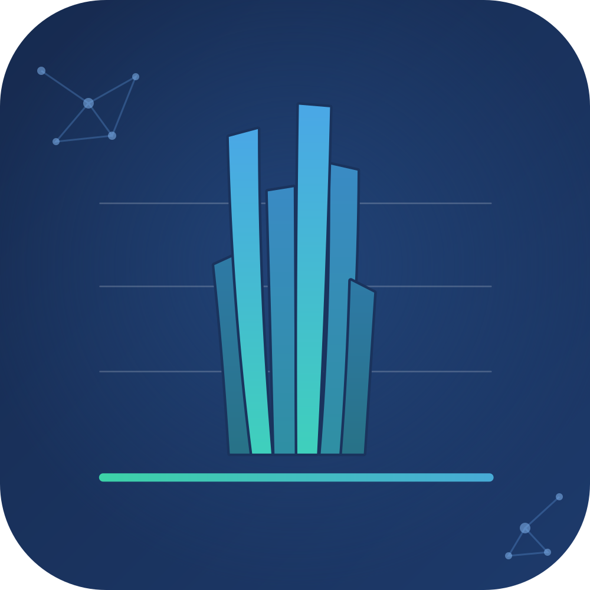

<p align="center">
  <a href="https://github.com/dse-club-kfupm"></a>
</p>

<h1 align="center">Lithology Classification</h1>

<p align="center">
  <b>Identifying rock types along a well from well-log measurements</b><br>
  A term 262 applied project of the <a href="https://github.com/dse-club-kfupm">Data Engineering &amp; Science Club, KFUPM</a>
</p>

<p align="center">
  <a href="https://docs.python.org/3/tutorial/"></a>
  <a href="https://jupyter.org"></a>
  <a href="https://pandas.pydata.org"></a>
  <a href="https://scikit-learn.org"></a>
  <a href="https://matplotlib.org"></a>
  <a href="https://www.manim.community"></a>
</p>

<p align="center">
  <a href="https://github.com/dse-club-kfupm"></a>
  
  <a href="#evaluation"></a>
  <a href="data/README.md"></a>
  <a href="LICENSE"></a>
  <a href="https://github.com/dse-club-kfupm/262-lithology-classification/actions/workflows/format-check.yml"></a>
</p>

<p align="center">
  <a href="#overview"><b>Overview</b></a> ·
  <a href="#dataset"><b>Dataset</b></a> ·
  <a href="#learning-path"><b>Learning path</b></a> ·
  <a href="#getting-started"><b>Getting started</b></a> ·
  <a href="#workflow"><b>Workflow</b></a> ·
  <a href="#deliverables"><b>Deliverables</b></a> ·
  <a href="#evaluation"><b>Evaluation</b></a> ·
  <a href="#rules"><b>Rules</b></a>
</p>

## Overview

When a well is drilled, instruments lowered into the hole record how the surrounding rock responds to natural radiation, sound and electric current along its depth. Petrophysicists interpret these measurements, called well logs, to decide which rock lies at each depth: the shale that seals a reservoir, the sandstone or carbonate that may hold oil and gas, and everything in between.

In this project you build a classifier that predicts the rock group at each depth from five standard well-log measurements.

> [!NOTE]
> This is a case study. You will not interpret a real well for drilling decisions. You work with one table of measurements from Norwegian offshore wells, released for the FORCE 2020 machine learning competition, and show how the data science workflow (understanding, cleaning, exploring, modelling and communicating) answers the question on that table.

### Project summary

|  |  |
| --- | --- |
| **Stakeholder** | A petrophysics team that must interpret many new wells faster than manual log analysis allows |
| **Question** | Given the log measurements at a depth, which rock group is present? |
| **Target** | `rock_group`: `Shale`, `Sandstone`, `Carbonate` or `Other` |
| **Evaluation** | Balanced accuracy on wells the model has never seen ([details](#evaluation)) |
| **Training data** | 381,331 depth readings from 94 wells × 8 columns in `data/train.csv` |
| **Level** | Introductory: DATA 211, Introduction to Data Science |
| **Assessment** | 100 points: 50 for the prediction, 50 for charts, slides and an animation |

## Dataset

`data/train.csv` holds 381,331 rows from 94 of the competition's wells. The committee keeps other whole wells as the hidden test set, so the model is tested on wells it has never seen.

The original interpretation has twelve lithology classes. They are grouped into four: Shale (shale, sandstone/shale and marl), Sandstone, Carbonate (limestone, chalk and dolomite) and Other (anhydrite, halite, coal, tuff and basement).

| Column | Description | Unit |
| --- | --- | --- |
| `well` | Well name; not a feature | text |
| `depth_m` | Measured depth along the well | m |
| `GR` | Gamma ray: natural radioactivity, usually high in shale | API units |
| `RHOB` | Bulk density of the rock | g/cm³ |
| `NPHI` | Neutron porosity: an estimate of pore space | fraction |
| `DTC` | Compressional sonic slowness: travel time of sound over one foot | µs/ft |
| `RDEP` | Deep resistivity: resistance to electric current | ohm·m |
| `rock_group` | **Target:** `Shale`, `Sandstone`, `Carbonate` or `Other` | label |

Test rows contain every column except `rock_group`.

### Data considerations

- **Validate by well, not by row.** Neighbouring rows in one well are almost identical, so a random split leaks answers into the validation set. Keep whole wells apart (`GroupShuffleSplit` with `well` as the group), as the hidden test does.
- **Class imbalance.** About 76% of rows are Shale, 14% Sandstone, 6% Carbonate and 3% Other. A model that always predicts Shale is right most of the time and still scores only 25%.
- **Missing logs.** Some logs were not recorded in every well: about 32% of `NPHI`, 13% of `RHOB` and 7% of `DTC` values are missing.
- **Data size.** With almost 400,000 rows, test ideas on a few wells first, then train on the full set.

**Source.** FORCE 2020 well log and lithofacies dataset, Bormann, Aursand, Dilib, Manral and Dischington (2020), DOI [10.5281/zenodo.4351156](https://doi.org/10.5281/zenodo.4351156). Well logs: Norwegian Licence for Open Government Data (NLOD) 2.0. Lithology interpretation: CC BY 4.0.

## Learning path

The project assumes the level of DATA 211, Introduction to Data Science. If you have completed it, review the list and open only the topics you are unsure about. Each topic is needed by a specific milestone, so you can learn it just before that milestone. Most Kaggle Learn courses take a few hours and run in the browser.

| When | Topic | Why it is needed | Start with | Go further |
| --- | --- | --- | --- | --- |
| Before you start | Git and GitHub | Every change reaches `main` through a reviewed pull request | [Introduction to GitHub](https://github.com/skills/introduction-to-github) · GitHub Skills | [Pro Git](https://git-scm.com/book/en/v2), chapters 1 to 3 |
| Before you start | Python | The notebooks and `predict.py` are written in Python | [Python](https://www.kaggle.com/learn/python) · Kaggle Learn | [The Python Tutorial](https://docs.python.org/3/tutorial/) · python.org |
| Before you start | Environments | Install the project's packages in isolation | [Virtual environments and packages](https://docs.python.org/3/tutorial/venv.html) · python.org |  |
| Milestone 1 | pandas | Load, inspect and reshape the table | [Pandas](https://www.kaggle.com/learn/pandas) · Kaggle Learn | [10 minutes to pandas](https://pandas.pydata.org/docs/user_guide/10min.html) · pandas docs |
| Milestone 1 | Data cleaning | Handle missing and unusual values | [Data Cleaning](https://www.kaggle.com/learn/data-cleaning) · Kaggle Learn | [Working with missing data](https://pandas.pydata.org/docs/user_guide/missing_data.html) · pandas docs |
| Milestone 1 | Domain background | Understand what each column measures | [FORCE 2020 competition repository](https://github.com/bolgebrygg/Force-2020-Machine-Learning-competition) · wells and original classes |  |
| Milestone 2 | Visualisation | Show how the features relate to the target | [Data Visualization](https://www.kaggle.com/learn/data-visualization) · Kaggle Learn | [Ten Simple Rules for Better Figures](https://doi.org/10.1371/journal.pcbi.1003833) · PLOS |
| Milestone 3 | Modelling | Train a first model and compare it with the baseline | [Intro to Machine Learning](https://www.kaggle.com/learn/intro-to-machine-learning) · Kaggle Learn | [Getting started](https://scikit-learn.org/stable/getting_started.html) · scikit-learn |
| Milestone 3 | Better models | Pipelines, categorical features, missing values and leakage | [Intermediate Machine Learning](https://www.kaggle.com/learn/intermediate-machine-learning) · Kaggle Learn | [Feature Engineering](https://www.kaggle.com/learn/feature-engineering) · Kaggle Learn |
| Milestone 3 | Evaluation | Balanced accuracy and validation on held-out wells (see the section on grouped data) | [Balanced accuracy](https://scikit-learn.org/stable/modules/model_evaluation.html#balanced-accuracy-score) · scikit-learn | [Cross-validation](https://scikit-learn.org/stable/modules/cross_validation.html) · scikit-learn |
| Milestone 4 | Animation | Explain the result in motion, in up to 2 minutes | [Quickstart](https://docs.manim.community/en/stable/tutorials/quickstart.html) · Manim | [Animations using Matplotlib](https://matplotlib.org/stable/users/explain/animations/animations.html) · Matplotlib |
| Milestone 4 | Presentation | Take the stakeholder from the question to the answer in 5 to 7 slides | [Ten Simple Rules for Making Good Oral Presentations](https://doi.org/10.1371/journal.pcbi.0030077) · PLOS |  |

## Getting started

You need Python 3.10 or newer and Git.

```bash
git clone https://github.com/dse-club-kfupm/262-lithology-classification.git
cd 262-lithology-classification
python -m venv .venv
source .venv/bin/activate        # Windows: .venv\Scripts\activate
pip install -r requirements.txt
jupyter lab
```

Then open `notebooks/01_data_understanding.ipynb` and work through its questions.

- **No local setup?** Google Colab also works: upload `data/train.csv`, and commit your notebooks back to this repository.
- **Preparing the animation?** Install Manim separately with `pip install manim`, after the system packages listed in the [Manim installation guide](https://docs.manim.community/en/stable/installation.html).
- **Questions?** Ask in the organization's [Discussions](https://github.com/orgs/dse-club-kfupm/discussions) or open an issue with the Question template.

## Workflow

The work is divided into four milestones. Each milestone has its own issues in the [Issues tab](https://github.com/dse-club-kfupm/262-lithology-classification/issues) and is complete when all of them are closed.

| Milestone | Complete when |
| --- | --- |
| 1. Data understanding | Notebook 01 and the cleaning functions in `src/features.py` are merged |
| 2. Exploration | Notebook 02, with charts and written findings, is merged |
| 3. Prediction submission | Notebook 03 and `src/predict.py` are merged and pass the format check |
| 4. Visual communication | The slides and the animation or video are merged |

For every change:

1. Choose an open issue and assign yourself to it.
2. Create a branch for it: `git switch -c short-description`.
3. Commit in small steps with clear messages, then push the branch.
4. Open a pull request into `main` and write `Closes #<issue number>` in its description.
5. A teammate reviews it. Once it is approved and the format check has passed, merge it.

Files in `data/`, `tests/` and `.github/` are owned by the committee: a pull request that changes them also needs a committee review.

**Validation guidance for milestone 3.** Split by well, as the hidden test does: keep a few whole wells for validation (`GroupShuffleSplit` with the `well` column as the group).

## Deliverables

**Part A · Prediction (50 points)**

- [ ] `src/predict.py` with a function `predict(df)`. It receives a table with the test columns and returns one of `Shale`, `Sandstone`, `Carbonate` or `Other` for each row, in the same order as the rows of `df`.
- [ ] Notebooks 01 to 03, run from top to bottom, documenting how the model was developed.
- [ ] A passing format check. Run `python tests/check_submission.py` from the repository root before the final pull request; the same check runs automatically on every pull request.

**Part B · Visual communication (50 points)**

- [ ] Clear, labelled charts in the notebooks.
- [ ] 5 to 7 slides that take the stakeholder from the question to the answer, saved as PDF in `visuals/slides/`.
- [ ] An animation or a short video of up to 2 minutes made with Python (Manim or matplotlib), with its source code and the rendered file in `visuals/animation/`. A suggested subject: a virtual well drilled downward, with the logs drawn as curves and the predicted rock group coloured beside them.

## Evaluation

`predict.py` is run once on the hidden test set after the submission deadline. A team receives the points of the highest level it reaches; the levels are not added together.

| Level | Requirement | Points |
| --- | --- | --- |
| Runs | Returns a valid prediction for every test row | 10 |
| Bronze | Balanced accuracy above the baseline's 25.0% (the baseline always predicts the most common rock group) | 30 |
| Silver | Balanced accuracy of at least 46.0% | 40 |
| Gold | Balanced accuracy of at least 67.0%, the committee's reference model | 50 |

Balanced accuracy is the average, over the four rock groups, of the share of rows in each group that the model labels correctly. A model that always gives the same answer scores 25%.

| Part B | Missing | Basic | Good | Excellent |
| --- | --- | --- | --- | --- |
| Charts in the notebooks | 0 | 5 | 10 | 15 |
| Slides, 5 to 7, as PDF | 0 | 5 | 10 | 15 |
| Animation or video, made with Python, up to 2 minutes | 0 | 7 | 14 | 20 |

> [!IMPORTANT]
> Any team member may be asked to explain any part of the work. If no one can, the Part A points do not count.

## Rules

- Train only on `data/train.csv`.
- Using other FORCE 2020 files, or any other well data, for training or prediction is not allowed.
- Every change reaches `main` through a pull request reviewed by a teammate.
- `predict.py` may use only pandas, NumPy and scikit-learn, so that it runs in the grading environment. Notebooks and visuals may also use matplotlib, seaborn, plotly and Manim.
- AI tools are allowed if they are declared in the Credits section, and every member must be able to explain the work.
- Follow the organization's [code of conduct](https://github.com/dse-club-kfupm/.github/blob/main/CODE_OF_CONDUCT.md).

## Repository structure

```text
262-lithology-classification/
├── README.md
├── LICENSE                     MIT licence for the code
├── requirements.txt
├── data/
│   ├── train.csv
│   └── README.md               source and licence of the data
├── notebooks/
│   ├── 01_data_understanding.ipynb
│   ├── 02_cleaning_and_exploration.ipynb
│   └── 03_modelling.ipynb
├── src/
│   ├── features.py             cleaning and feature functions
│   └── predict.py              submission entry point
├── models/                     saved model, if predict.py loads one
├── tests/
│   └── check_submission.py     format check, run before submitting
└── visuals/
    ├── slides/                 presentation as PDF
    └── animation/              animation source code and rendered video
```

## Credits

- **Project leads:** Name (@github), Name (@github)
- **Contributors:** Name (@github)
- **Organized by:** Applied Projects Committee, Data Engineering & Science Club, KFUPM
- **Data:** FORCE 2020 well log and lithofacies dataset, Bormann, Aursand, Dilib, Manral and Dischington (2020), DOI 10.5281/zenodo.4351156. Well logs: NLOD 2.0. Lithology interpretation: CC BY 4.0.
- **AI tools used:** none, or name the tool and what it was used for
- **Licence:** the code is released under the [MIT licence](LICENSE); the data keeps its own licence, described in [data/README.md](data/README.md).

---

<p align="center">
  <sub>Applied Projects Committee · <a href="https://github.com/dse-club-kfupm">Data Engineering &amp; Science Club, KFUPM</a> · نادي هندسة وعلوم البيانات</sub>
</p>
